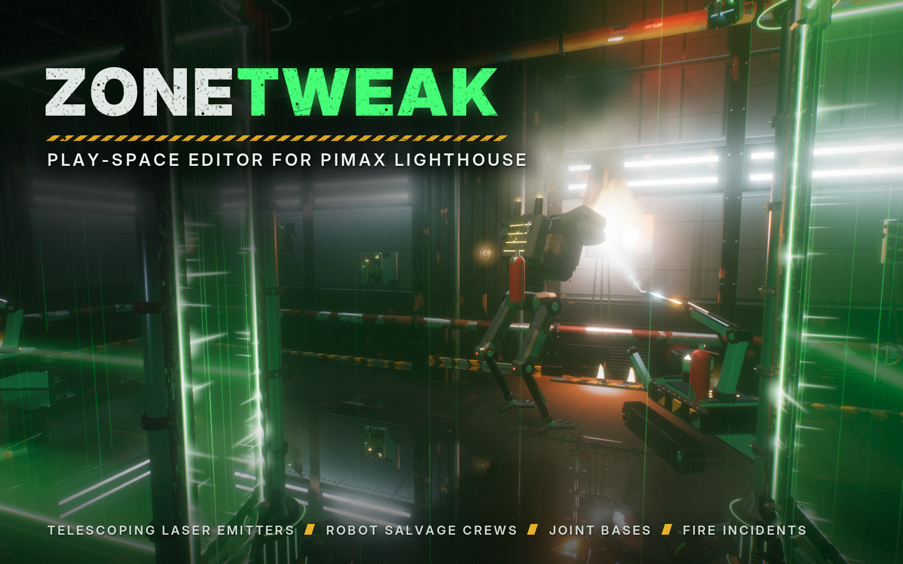

# ZoneTweak — for Pimax and SteamVR



An in-headset editor for your VR boundary, in the spirit of ChaperoneTweak: the Pimax
**safety zone** or the **SteamVR chaperone**. You stand in your room, grab the boundary's
corner posts and drag them where you want, then save straight into the runtime's own files.

It runs on **OpenXR** and edits the boundary of whichever runtime is active, with nothing to
pick:

- **Pimax Play / Evo:** `C:\ProgramData\Pimax\runtime\chaperone_info*.vrchap`; Pimax loads
  it after a restart (ZoneTweak can restart it for you).
- **SteamVR** (Index, Vive, Bigscreen Beyond, Pimax through SteamVR...):
  `Steam\config\chaperone_info.vrchap`, in the universe SteamVR is using right now. SteamVR
  reloads it live when you save, and the zone settings change SteamVR's chaperone settings
  live too.

## Features

- **Edit the boundary in VR**: move, add and delete corners with a floor beam or a laser
  pointer. Undo, Square Up, Simplify and optional magnetic snapping.
- **Saved play spaces**: name layouts (for example "Door open" / "Door closed") and switch
  between them in VR or from a desktop shortcut (`ZoneTweak.exe --use "Door open"`).
- **Play area tools**: move, rotate and stretch the play area, and fit or center it in the room.
- **Zone settings Pimax Evo doesn't expose**: the warning (proximity) distance and the
  safety zone on/off switch, with a live proximity test.
- **Safe saving**: timestamped `.bak` copies before the first write, a Revert option, Restore
  Original, and Save & Restart Pimax.
- **Shows your real base stations** from the Lighthouse database.
- **Deleting a post** plays one of four random exits (decommission, ceiling extraction,
  floor hatch, overload) while the boundary updates instantly.
- **Set dressing (visual only)**: the boundary is drawn as laser walls between generator
  posts in a grim industrial prison, with robots that repair, salvage and fight the
  occasional fire, and Contraband's leech drones roaming the hall from door to door. All procedural, with a fully synthesized sound engine. None of it is
  written to Pimax.
- **Graphics presets**: from Ultra down to Potato, applied instantly, plus a render scale,
  fixed foveated rendering on NVIDIA GPUs and live per-pass GPU timings on the graphics page.

The full user manual is in [`docs/MANUAL.txt`](docs/MANUAL.txt).

## Contraband: the bonus game

*Tweak your zone. Then defend it.*

ZoneTweak has a game built in. Press **PLAY CONTRABAND** at the top of the menu: the view
fades to black and comes back with your controllers turned into gloves. The room you just
shaped is now a prison cell, and you have to hold it.

- **The goal:** a half-built EMP sits on a cart in your room. Finish it by hand,
  stage by stage, then start its engine and hit the big red button. If a warden
  carries the cart out of one of the four doors, you lose.
- **Your walls:** your real boundary is a ring of laser walls held up by generators.
  Wardens lean on the walls to drain them. Pump a generator's handle to top it up,
  or hold **A** to supercharge a span and fry whatever's touching it.
- **Your maze:** before the round, draw magenta walls out in the hall with the
  trigger so the wardens have to walk the long way round. Hold **B** on a wall to
  supercharge it.
- **Building the EMP:** every stage is physical. You unscrew a plate (find the
  screwdriver and wrench), plug in wires, wind a coil and read a serial number by
  flashlight. Twice the device wants a game: one of seven, such as Simon, cracking
  a safe dial by feel, a switchboard, or a code you have to walk round the cart to
  read.
- **Leeches:** these drones clamp onto your generators. Rip their tethers off, or
  zap them with the prod, which hangs in a bracket on one of the generators.
- **The harpoon:** from a quarter of the way through, a turret rises. Use it to reel
  in wardens, string live wires across the floor, or win the cart back.
- **The radio:** your contact only talks into the handset. Pick it up to hear the
  next wave, where your tools are, and how to fix the EMP when it misfires.

To come back, open the pause menu (**B**) and pick **BACK TO ZONETWEAK**. To launch straight into the game,
use `ZoneTweak.exe --play`. The full guide covers the controls, every stage, every
game and the misfire repair: [`docs/HOW-TO-PLAY.txt`](docs/HOW-TO-PLAY.txt).

The game's rules engine (in `sim/`) runs without any graphics. A simulated player
plays whole rounds to tune the difficulty ([`docs/balance-settings.md`](docs/balance-settings.md)).

## Running it

1. Start Pimax Play / Evo with the headset on.
2. Run `ZoneTweak.exe` once from Windows. That adds it to Pimax's app library, so after
   that you can launch it from inside VR.
3. Keep `openxr_loader.dll` and `openvr_api.dll` next to the exe.

With SteamVR, set it as the OpenXR runtime and start ZoneTweak while SteamVR is running.

If saving reports "access denied", run it as administrator.

## Switching play spaces without the headset

Every space you save in VR (Menu → Saved Spaces → Save As New) can also be applied from
Windows. ZoneTweak doesn't start VR in that case: it writes that space's boundary, then has
a running SteamVR reload it live, or offers to restart Pimax so the new boundary loads.

1. In VR, save your spaces, for example `Door open` and `Door closed`.
2. Right-click `ZoneTweak.exe` → Create shortcut.
3. Right-click the shortcut → Properties, and add `--use` plus the space name to **Target**:
   ```
   "C:\Games\ZoneTweak\ZoneTweak.exe" --use Door open
   ```
4. Name the shortcut after the space, and make one shortcut per space.

Double-click a shortcut to switch. If the name doesn't match a saved space, it lists the
spaces you have.

## Building

Go 1.24+, standard library only (no cgo). It builds on any OS for Windows x64:

```sh
GOOS=windows GOARCH=amd64 go build -trimpath -ldflags "-H windowsgui -s -w" -o ZoneTweak.exe .
```

At runtime it needs the Khronos `openxr_loader.dll` (Apache-2.0, from the
[OpenXR SDK](https://github.com/KhronosGroup/OpenXR-SDK-Source/releases)) beside the exe, and
Valve's `openvr_api.dll` (BSD-3-Clause, from the
[OpenVR SDK](https://github.com/ValveSoftware/openvr), `bin/win64`) for the live SteamVR
reload and settings. SteamVR calls run in a short-lived copy of the exe
(`--steamvr-reload`, `--steamvr-set`, `--steamvr-live`) so they never share a process with
the OpenXR session.

- **Shaders** live in `shaders/` and are embedded at build time; so are the radio's voice
  clips (`voice/*.raw`, made with Kokoro TTS by the scripts beside them).
- **Preview:** on Linux, `go build -o preview/prevbin . && preview/shot.sh out.png
  "eye,look"` renders a frame of the game with the real shaders (see `preview/`).
- **Icon:** `rsrc_windows_amd64.syso` carries the icon (generated by `art/mksyso.py`).
- **Cover and icon art:** made by `art/make_art.py`.

Tests: `go test ./...` (the Lighthouse test skips unless you drop your own
`testdata/lighthousedb.json` and `testdata/chaperone_info.vrchap` in place).

## License

MIT, see [`LICENSE`](LICENSE). Use it for anything.

## Disclaimer

This is an unofficial community tool, not affiliated with Pimax or Valve. It edits the
runtimes' boundary files; it backs them up first, but use it at your own risk.
